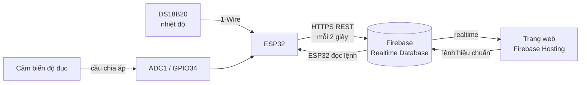

# Hệ thống giám sát chất lượng nước (ESP32 + Firebase)

Đo **nhiệt độ** và **độ đục** của nước bằng ESP32, gửi dữ liệu lên Firebase Realtime Database mỗi 2 giây, hiển thị thời gian thực trên trang web và cho phép **hiệu chuẩn cảm biến từ xa** ngay trên web.

## Demo

<!-- Thêm ảnh vào thư mục docs/ rồi bỏ dấu comment các dòng dưới -->
<!--  -->
<!--  -->

Trang web: [link Firebase Hosting của dự án]

## Sơ đồ hệ thống



## Tính năng

- Đo nhiệt độ bằng DS18B20 theo kiểu **không chặn chương trình** (non-blocking)
- Đo độ đục, quy đổi điện áp sang **NTU** bằng hiệu chuẩn 2 điểm
- **Lọc nhiễu ADC**: lấy 64 mẫu, sắp xếp, bỏ 1/4 thấp nhất và 1/4 cao nhất rồi lấy trung bình, sau đó làm mượt bằng bộ lọc EMA
- Gửi dữ liệu lên Firebase qua **REST API (HTTPS)**, dùng timestamp của server
- **Hiệu chuẩn từ xa**: bấm nút trên web, ESP32 đo 5 giây, kiểm tra độ ổn định, lưu kết quả vào bộ nhớ NVS (giữ nguyên khi mất điện)
- Web hiển thị trạng thái kết nối và phát hiện khi thiết bị ngừng gửi dữ liệu
- WiFi tự kết nối lại khi mất mạng

## Phần cứng

| Linh kiện | Chức năng |
|---|---|
| ESP32 DOIT DevKit V1 | Vi điều khiển chính, kết nối WiFi |
| DS18B20 | Cảm biến nhiệt độ (giao tiếp 1-Wire) |
| Cảm biến độ đục (ngõ ra analog) | Đo độ đục của nước |
| Điện trở 4.7 kΩ | Điện trở kéo lên cho đường DATA của DS18B20 |
| Điện trở 10 kΩ + 15 kΩ | Cầu chia áp hạ điện áp cảm biến độ đục về mức an toàn cho ADC |

### Sơ đồ đấu nối

| Cảm biến | Chân | Nối tới ESP32 | Ghi chú |
|---|---|---|---|
| DS18B20 | DATA | GPIO21 | Kéo lên 3.3V qua 4.7 kΩ |
| Cảm biến độ đục | OUT | GPIO34 | OUT —[10 kΩ]— GPIO34 —[15 kΩ]— GND |

GPIO34 thuộc **ADC1**: ADC2 của ESP32 không dùng được khi WiFi đang bật.

## Xử lý tín hiệu độ đục

1. Đọc 64 mẫu bằng `analogReadMilliVolts`, sắp xếp chèn (insertion sort)
2. Bỏ 25% mẫu thấp nhất và 25% cao nhất để loại gai nhiễu do WiFi phát sóng, lấy trung bình phần còn lại
3. Nhân hệ số cầu chia áp (25/15) để ra điện áp thực của cảm biến
4. Làm mượt giữa các lần đo bằng bộ lọc EMA (α = 0.3)
5. Quy đổi sang NTU:

```
NTU = NTU_REF × (U_clean − U) / (U_clean − U_ref)     (giới hạn 0 – 3000 NTU)
```

`U_clean` là điện áp khi đo nước sạch, được cập nhật qua chức năng hiệu chuẩn.

## Hiệu chuẩn từ xa

1. Web ghi lệnh vào `/control/calibrate`
2. ESP32 đọc lệnh (mỗi 2 giây), lấy 25 mẫu trong 5 giây
3. Kết quả:
   - `unstable`: dao động lớn hơn 40 mV (nước đang khuấy, có bọt khí)
   - `too_low`: điện áp quá thấp, nước chưa đủ sạch
   - `ok`: lưu `U_clean` mới vào NVS
4. ESP32 ghi kết quả vào `/calibration` và xóa lệnh đã xử lý

## Cấu trúc dữ liệu trên Firebase

| Đường dẫn | Ai ghi | Nội dung |
|---|---|---|
| `/sensors` | ESP32 | `temperature`, `temp_ok`, `voltage_mv`, `ntu`, `updated` |
| `/calibration` | ESP32 | `status`, `measured_mv`, `range_mv`, `u_clean_mv`, `u_ref_mv`, `ntu_ref`, `at` |
| `/control/calibrate` | Web | Lệnh hiệu chuẩn (ESP32 đọc rồi xóa) |

## Cấu trúc thư mục

```
├── src/
│   ├── main.cpp              # Firmware ESP32
│   └── secret_example.h      # Mẫu cấu hình WiFi và Firebase
├── public/
│   └── index.html            # Trang web giám sát (Firebase Hosting)
├── platformio.ini            # Cấu hình PlatformIO và thư viện
└── firebase.json             # Cấu hình Firebase Hosting
```

## Cài đặt và chạy

**Firmware ESP32**

1. Mở thư mục dự án bằng VS Code đã cài PlatformIO
2. Sao chép `src/secret_example.h` thành `src/secret.h`, điền WiFi, địa chỉ database và database secret
3. Bấm **Build** rồi **Upload** để nạp vào ESP32

**Trang web**

1. Sửa phần `firebaseConfig` trong `public/index.html` theo project Firebase của bạn
2. Triển khai: `firebase deploy --only hosting`

## Hạn chế và hướng phát triển

- Đang bỏ qua kiểm tra chứng chỉ SSL (`setInsecure`); cần nạp chứng chỉ gốc (root CA) để chống giả mạo máy chủ
- Đang dùng Database secret (cách xác thực cũ của Firebase); có thể chuyển sang Firebase Authentication
- Thông số `U_REF` và `NTU_REF` cần đo bằng dung dịch chuẩn để kết quả NTU chính xác hơn
- Lưu lịch sử đo và vẽ biểu đồ theo thời gian
- Cảnh báo khi nhiệt độ hoặc độ đục vượt ngưỡng
- Thử nghiệm giao thức MQTT thay cho REST

## Tác giả

Nguyễn Khắc Hùng Cường – Sinh viên Kỹ thuật máy tính, chuyên ngành IoT và Hệ thống nhúng
